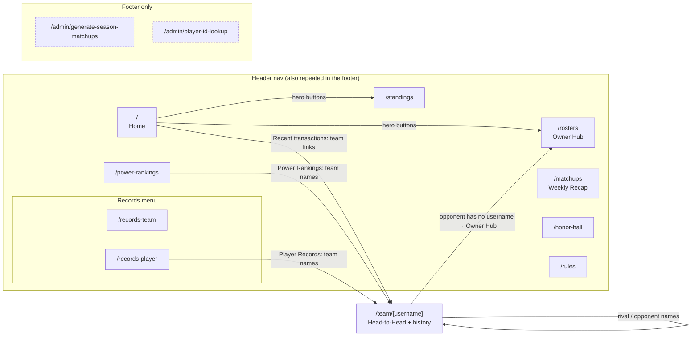
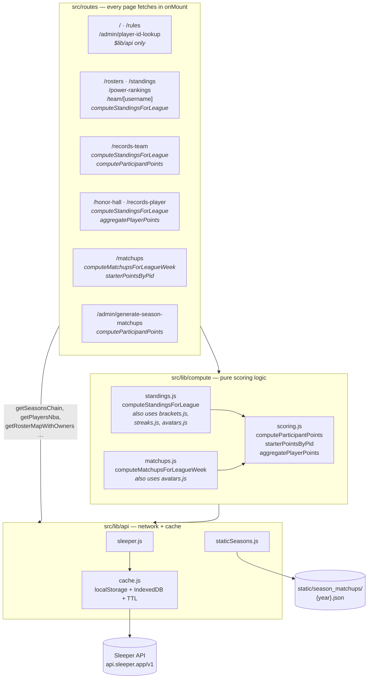

# Badger Fantasy Association

A modern web companion for the BFA fantasy basketball league. Pulls every stat,
matchup, roster, and bracket from the [Sleeper](https://sleeper.com) public API,
slices it across every season the league has ever played, and renders it in a
single dark, brand-themed SvelteKit app.

Live on Vercel. No login or application server. League data is fetched directly
from Sleeper and cached in the browser.

---

## What's in here

| Route             | What you'll find                                                |
| ----------------- | --------------------------------------------------------------- |
| `/`               | BFA hero, "Rando Player" spotlight, and filterable Recent Transactions (trades, waivers, free agents) |
| `/rosters`        | Single-team **Owner Hub** — career stats, Franchise Records, starters / bench / taxi |
| `/standings`      | Regular-season + playoff records with weekly PF trend sparklines and the Regular Season MVP Race |
| `/matchups`       | **Weekly Recap** — Top 3 Performances, Biggest Blowout, Closest Game, Highest-Scoring Matchup, Bust of the Week, plus head-to-head cards |
| `/power-rankings` | Rolling four-week form: W-L, average score, margin, score trend, and movement |
| `/team/[username]`| Per-roster matchup history — H2H summary, opponent records, and weekly results |
| `/records-team`   | All-time team records, biggest blowouts/nailbiters, and head-to-head matrix |
| `/records-player` | Season MVPs, All-Time MVP Awards, All-Time Best Player by Team, and cumulative Regular Season / Playoffs scoring leaders by franchise |
| `/honor-hall`     | Champions, Biggest Loser, three MVPs, and final standings |
| `/admin/generate-season-matchups` | Browser-based season snapshot utility |

### Site map

Every page in the box is one click away in the header nav. The two admin tools
are reachable only from the footer. Arrows show the other links between pages;
`/team/[username]` is reached from anywhere a team name is listed.



### Three different MVPs, three different definitions

The league has three MVP awards per season and they're easy to confuse, so:

- **Regular Season MVP** — top cumulative scorer across the regular season ONLY
  (no playoff points). Surfaces on the Honor Hall page and Records-Player.
- **Playoffs MVP** — top cumulative scorer across just the playoff window,
  filtered to only count rosters that actually made the playoffs (seeds 1–8
  via `leagueMeta.settings.playoff_teams`). So a toilet-bowl scorer can't
  steal this trophy.
- **Finals MVP** — top scorer in the single championship game, counting players
  from **both** finalists. So if you lose the final but drop 60, you still take
  home the trophy.

### Scoring rules and weekly recap

All team matchup scores used by standings and season-wide matchup records come
from the checked-in per-season files at
`static/season_matchups/{year}.json`. Each season is maintained independently
(e.g. `2022.json`, `2023.json`, …, `2026.json`).

For every team in a matchup, the file stores:
- Sleeper roster ID, team name, and owner label
- The selected starter player IDs (`starters`)
- The corresponding player scores in `starters_points`, in the same order

Each matchup row stores explicit `teamAScore` and `teamBScore` totals. These
are the authoritative team scores used by standings, Weekly Recap, and other
team-level stats. Team-score precedence is: a saved BFA historical override,
Sleeper `custom_points`, Sleeper `points`, then the aligned `starters_points`
sum only when Sleeper does not provide a team total. The app does not
recalculate a saved total when one is present. Player-level statistics still
use `starters` zipped to the matching `starters_points` array; bench players
and raw `player_points` / `players_points` are never included. The 2023 early-
season BFA corrections are stored directly in `2023.json` with a
`bfa_historical_override` source marker—there is no separate early-2023 file.

**Manual BFA score overrides are protected.** Values marked
`bfa_historical_override`, along with unmarked legacy scores, are preserved by
routine generation. Automatically generated Sleeper totals carry a source
marker and can be refreshed by the weekly sync when Sleeper posts scoring
corrections.

Player-level weekly stats (such as Top Performances and Bust of the Week) also
use the selected starters and their aligned `starters_points` values. Raw
`player_points` / `players_points` are not used: they can include unselected
games when a manager uses Sleeper's manual game-selection feature.

The site applies one shared completed-week cutoff to every stats page:
Standings, Trends / Power Rankings, Team Records, Player Records, Honor Hall,
Owner Hub, and team matchup history. During an active season, only weeks before
Sleeper's current `settings.leg` are eligible. The in-progress week is never
counted. A fantasy week runs Monday at 3:00 AM through the following Monday at
2:59 AM Eastern.

Completed seasons are capped at that season's configured final playoff week;
pre-draft, drafting, and unknown seasons expose no weekly stats. The Owner Hub
uses the same completed matchup snapshots for scores and results. Its live
schedule lookup is used only to label upcoming opponents, never to count an
upcoming week as a played result.

### Owner Hub (rosters page)

`/rosters` is a single-team view controlled by a top-of-page dropdown. Pick a
team and the page shows that owner's **Owner Hub** — a 10-stat career snapshot
built by aggregating `computeStandingsForLeague()` across every season in the
chain, keyed by `owner_username` so re-themes and avatar swaps don't break
continuity:

- Titles 🏆
- Playoff Appearances
- Finals Appearances
- Best Finish (with year)
- Career Wins / Losses / Win %
- Career PF / PA
- Best Season PF (with year)

Below the Owner Hub the page lists **Franchise Records** (best single game,
best playoff game, highest / lowest week, biggest blowout win + loss, longest
win + lose streak, best season record) followed by the picked team's current
**Starters**, **Bench**, and **Taxi Squad**.

### Head-to-Head (`/team/[username]`)

Each team-history page leads with an **H2H block**:

- **Biggest Rival** — most-played opponent across the entire league chain.
- **Longest H2H Win Streak** — longest run of consecutive wins vs any single
  opponent, computed chronologically (regular + playoff games combined).
- **Per-opponent table** — GP · W-L · Win% · PF · PA · Last 3 results.

---

## Architecture (the short version)

```
src/
├── lib/
│   ├── api/
│   │   ├── sleeper.js             Sleeper REST wrapper, season-chain discovery, BASE_LEAGUE_ID
│   │   ├── cache.js               TTL cache: localStorage for small responses, IndexedDB for large data
│   │   ├── staticSeasons.js       Loader for /static/season_matchups/{year}.json snapshots
│   │   └── index.js               Barrel — `import { … } from '$lib/api'`
│   ├── compute/
│   │   ├── scoring.js             computeParticipantPoints, starterPointsByPid, aggregatePlayerPoints
│   │   ├── standings.js           Season standings, MVPs, snapshot-only scoring
│   │   ├── matchups.js            Weekly matchup rows
│   │   ├── brackets.js            Final standings + championship game from brackets
│   │   ├── avatars.js             Overlay each owner's latest team art on historical seasons
│   │   ├── streaks.js             Win/lose streak helper
│   │   └── index.js               Barrel — `import { … } from '$lib/compute'`
│   ├── components/
│   │   ├── Header.svelte          Sticky top nav
│   │   ├── Sparkline.svelte       SVG sparkline (standings + power-rankings)
│   │   ├── ErrorBoundary.svelte   Friendly error UI with retry
│   │   └── SkeletonLoader.svelte  Loading skeletons for tables/cards/rows
│   └── utils/
│       ├── format.js              formatNumber, avatarOrPlaceholder, playerDisplayName
│       ├── positions.js           Expand `fantasy_positions` to full slot eligibility (PG→PG,G,UTIL …)
│       ├── scoringLabels.js       Display labels for scoring categories
│       ├── dominantColor.js       Optional canvas-based dominant-color extractor (unused at the moment)
│       └── vitals.js              Web Vitals → Vercel Analytics
├── routes/                        One folder per page (+ /admin)
├── app.css                        BFA color tokens + global type/layout
└── app.html                       SvelteKit shell
static/
├── bfa-logo.png                   Brand mark used in header + footer
├── season_matchups/{year}.json    Per-season starter/points snapshots (2022 onward)
└── week-ranges.json               "Which week are we in right now" calendar
scripts/
├── regenerate-season-matchups.mjs Node script that rebuilds each season JSON
└── test-auto-discovery.mjs        Sanity-checks the season chain walk
```

### How the code fits together

Pages never talk to Sleeper directly; they go through `$lib/api` (network +
cache) and `$lib/compute` (pure scoring logic). The `compute` layer is where
"static snapshot vs live API" gets decided, so every page agrees on the numbers.



Shared display helpers (`formatNumber`, `avatarOrPlaceholder`,
`playerDisplayName`) live in `src/lib/utils/format.js` and are imported by the
pages directly.

### Everything runs in the browser

The first version of this site rendered standings server-side. That blew up on
Vercel because Sleeper's `/players/nba` response is ~5 MB — every page view
became a serverless cold start that timed out reading static files. The app
renders every route as a static HTML shell and fetches Sleeper data in the
browser. Small responses use a TTL-based `localStorage` cache; large responses
such as the NBA player directory use IndexedDB, with an in-memory cache and
request deduplication for the current page session.

In practice that means:

- Every `+page.svelte` does its data fetch in `onMount`.
- Every `+page.js` ships with `ssr = false`, `prerender = false`.
- No `+page.server.js` files anywhere. (Do not add one. It will 500 on Vercel.)

### Logos stay current across seasons

Owners keep the same Sleeper username across seasons, but roster IDs and team
art change every year. So when you look at the 2022 standings, you see each
owner's **current** logo, not the one they had three years ago. That overlay
lives in `getLatestOwnerAvatars()` (in `src/lib/compute/avatars.js`) and runs
once per page load.

### New seasons show up automatically

`getSeasonsChain()` walks the `previous_league_id` chain **backwards** to find
every historical season, then walks **forwards** via Sleeper's
`/user/{user_id}/leagues/nba/{season}` endpoint to pick up new seasons whose
`previous_league_id` chains back to a known league. So when the commissioner
spins up next year's league in Sleeper, every page (standings dropdown,
records, the home page's "current week" matchups, the latest team logos)
flips over with zero code changes. The anchor `BASE_LEAGUE_ID` only needs to
move if the chain itself is ever broken.

You can sanity-check the discovery against the live API with:

```bash
node scripts/test-auto-discovery.mjs
```

---

## Running it locally

```bash
yarn install
yarn dev          # http://localhost:5173
```

You don't need any environment variables. The league ID is baked into
`src/lib/api/sleeper.js` — `BASE_LEAGUE_ID` is just the anchor
`getSeasonsChain` starts from; new seasons after it are picked up
automatically via forward-discovery (see above), and historical seasons via
the backwards `previous_league_id` walk. You only need to touch the constant
if the league chain is ever broken (e.g. someone re-creates a season without
linking it back to the previous one).

## Production build

```bash
yarn build        # outputs to .svelte-kit/output
yarn preview      # serve the build locally to sanity-check
```

The Vercel adapter is pinned to `nodejs22.x` (Vercel's current default). Older
versions of `@sveltejs/adapter-vercel` rejected Node 22 — if you ever see
"Unsupported Node.js version" on a deploy, make sure
`@sveltejs/adapter-auto` is **not** in `package.json` (it can pull in a stale
adapter).

## Deploying

Push to GitHub and connect the repo to Vercel. Defaults are fine.

**Important**: `.vercel/output/` and `.svelte-kit/` are git-ignored on
purpose. If they ever land in the repo, Vercel treats `.vercel/output/` as a
precomputed build and skips `yarn build` entirely — so every source change
silently fails to deploy. The `.gitignore` already excludes them; just don't
commit them.

---

## Per-season scoring files

The files in `static/season_matchups/` are the canonical source for team
scoring across all seasons. The app does not fall back to live Sleeper matchup
totals when a season file or week is missing. Only weeks present in the
season's JSON are available to the scoring pipeline.

### File structure

Each year has its own file, for example:

```text
static/season_matchups/
├── 2022.json
├── 2023.json
├── 2024.json
├── 2025.json
└── 2026.json
```

A season file contains season playoff metadata and week-keyed matchup arrays.
Each matchup row includes a `matchup_id`, `week`, and two team objects
(`teamA` and `teamB`). A team object contains `rosterId`, `name`,
`ownerName`, `starters`, and `starters_points`. The two starter arrays are
positionally aligned: index 0 in `starters` identifies the player whose score
is at index 0 in `starters_points`.

Each matchup row stores `teamAScore` / `teamBScore` and a source marker when
the total was generated automatically. Explicit historical corrections are
stored directly in the same year file and always take precedence in the app.

### Regenerating the files

The full generator discovers the league's historical seasons by following
`previous_league_id`, then discovers later seasons through Sleeper's
user-leagues endpoint. Its manual regeneration mode can rebuild selected
season files; do not use that mode for the scheduled weekly sync.

Run it with Node 22 or later:

```bash
node scripts/regenerate-season-matchups.mjs
```

To regenerate selected seasons only:

```bash
node scripts/regenerate-season-matchups.mjs 2025 2026
```

The full generator fetches matchup weeks from Sleeper and stores selected
starter IDs with their matching `starters_points` values for player-level
statistics. Team totals use Sleeper `custom_points`, then Sleeper `points`, and
fall back to the aligned starter sum only when neither team-level total exists.
Explicit BFA historical overrides and unmarked legacy score values are
preserved unless a deliberate forced refresh is requested.

### Automatic refresh

The **Sync season matchup files** GitHub Actions workflow runs weekly
(Mondays at 09:20 UTC) and can also be started manually from the repository's
Actions tab. It runs `node scripts/regenerate-season-matchups.mjs --current-week`.
That mode reads Sleeper's current `settings.leg`, fetches only the immediately
preceding completed week, and changes only that week key in the current season
JSON. Automatically generated totals are refreshed from the latest Sleeper
response; unmarked legacy scores and explicit BFA overrides remain protected.
The workflow stages only modified files under `static/season_matchups/`.

No local machine or manual Vercel update is required for the scheduled refresh:
the workflow commits updated JSON files to GitHub, and the connected Vercel
project deploys from the repository as usual.

### Score calculation

For each team entry, team scoring follows this order:

1. Use the explicit saved `teamAScore` / `teamBScore` value when present.
2. Otherwise, use Sleeper `custom_points` when supplied.
3. Otherwise, use Sleeper `points` when supplied.
4. Only when no team total exists, sum `starters_points` after verifying that
   it aligns with the selected `starters` IDs.

Player-level records remain strictly starter-only and never use full-roster
`player_points` / `players_points`.

This keeps wins, losses, points for/against, standings, and downstream
season aggregates on the same starter-only scoring basis.

## Credits

Built with [SvelteKit 2](https://kit.svelte.dev) + [Svelte 5](https://svelte.dev),
deployed on [Vercel](https://vercel.com), powered by the
[Sleeper API](https://docs.sleeper.app/). NBA headshots via Sleeper's CDN.
Type set in Bebas Neue + Outfit.
