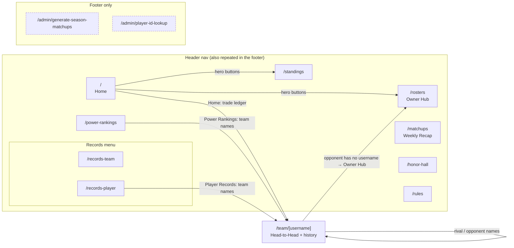
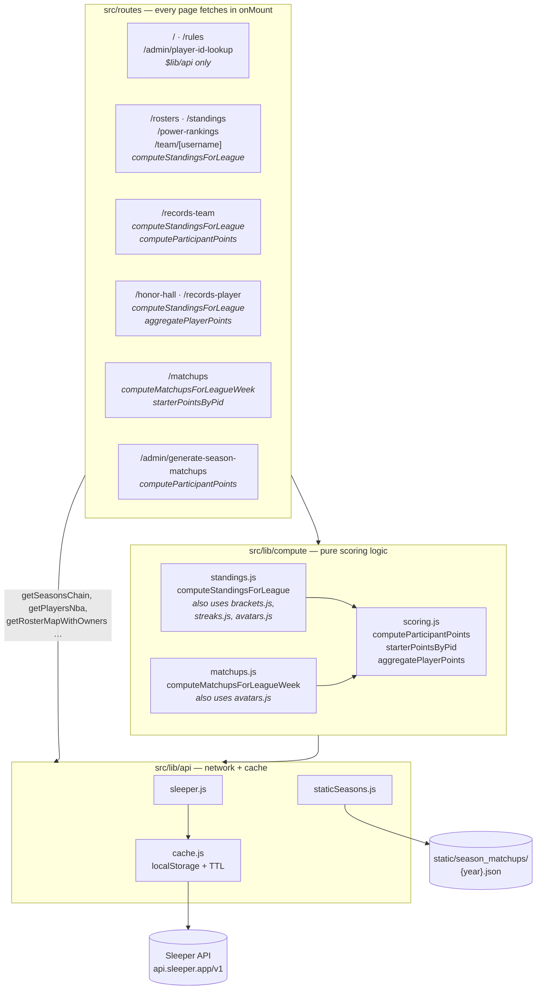
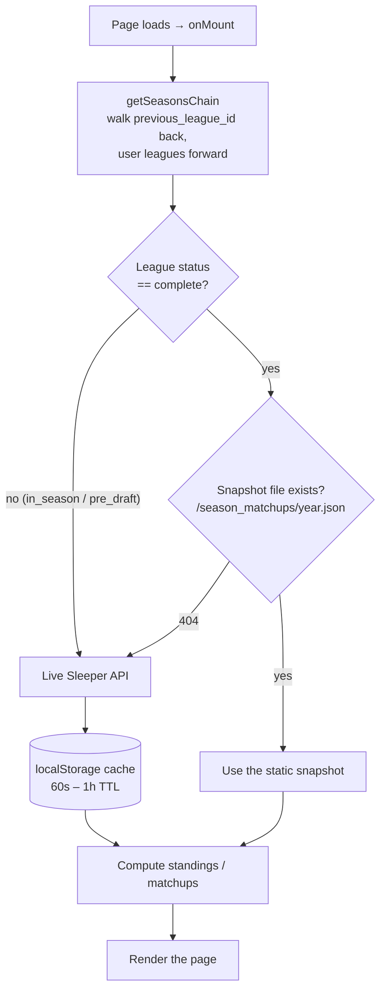
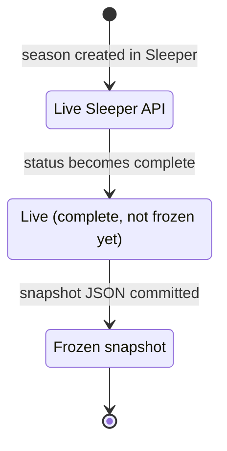

# Badger Fantasy Association

A modern web companion for the BFA fantasy basketball league. Pulls every stat,
matchup, roster, and bracket from the [Sleeper](https://sleeper.com) public API,
slices it across every season the league has ever played, and renders it in a
single dark, brand-themed SvelteKit app.

Live on Vercel. No login. No backend. No database.

---

## What's in here

| Route             | What you'll find                                                |
| ----------------- | --------------------------------------------------------------- |
| `/`               | Current-week matchups, "Rando Player" spotlight, recent Trade Ledger |
| `/rosters`        | Single-team **Owner Hub** picked by dropdown — career stats, Franchise Records, starters / bench / taxi |
| `/standings`      | Regular-season + playoff records with weekly PF trend sparklines, plus "Regular Season MVP Race" top-5 leaderboard |
| `/matchups`       | **Weekly Recap** — Top 3 Performances, Biggest Blowout, Closest Game, Highest-Scoring Matchup, Bust of the Week, plus every head-to-head card |
| `/power-rankings` | Rolling 4-week window: Last 4 W-L, avg score, avg margin, score trend, Δ vs prior |
| `/team/[username]`| Per-roster matchup history — Head-to-Head block (rival, longest H2H win streak, full opponent table) + every week's opponent and result |
| `/records-team`   | All-time aggregated W/L, biggest blowouts/nailbiters, head-to-head matrix |
| `/records-player` | Regular Season / Playoffs / Finals MVP per season + 4 all-time tables (Best By Team, Playoff Best, Full-Season Best, Playoffs Leaderboard) |
| `/honor-hall`     | Champion + Biggest Loser + three MVPs + final standings 1–14   |
| `/admin/generate-season-matchups` | Browser-based snapshot regenerator. Defaults to every completed season in the chain; override with `?years=2026,2027` |

### Site map

Every page in the box is one click away in the header nav. The two admin tools
are reachable only from the footer. Arrows show the other links between pages;
`/team/[username]` is reached from anywhere a team name is listed.



### Three different MVPs, three different definitions

The league has three MVP awards per season and they're easy to confuse, so:

- **Regular Season MVP** — top cumulative scorer across the regular season ONLY
  (no playoff points). Surfaces on the Honor Hall page and Records-Player.
- **Playoffs MVP** — top cumulative scorer across just the playoff window,
  filtered to only count rosters that actually made the playoffs (seeds 1–8
  via `leagueMeta.settings.playoff_teams`). So a toilet-bowl scorer can't
  steal this trophy.
- **Finals MVP** — top scorer in the single championship game, counting players
  from **both** finalists. So if you lose the final but drop 60, you still take
  home the trophy.

### The Weekly Recap (`/matchups`)

Every weekly stat that comes out of `recap` reads from one of TWO authoritative
data shapes — and never mixes them:

| Stat                          | Source                                            |
| ----------------------------- | ------------------------------------------------- |
| 🏀 Top 3 Performances         | `starters_points` only (via `starterPointsByPid`) |
| 🥶 Bust of the Week           | `starters_points` only (via `starterPointsByPid`) |
| 💥 Biggest Blowout            | Per-team `points` total (commish overrides via `custom_points`) |
| 🔥 Closest Game               | Per-team `points` total                           |
| 🎯 Highest-Scoring Matchup    | Per-team `points` total                           |
| 📈 Highest / 📉 Lowest Team   | Per-team `points` total                           |

**Critical:** Top 3 and Bust are STRICTLY starter scoring. `starterPointsByPid`
in `src/lib/compute/scoring.js` returns `null` if a Sleeper matchup entry lacks a
`starters_points` array — the caller skips that team entirely rather than
falling back to `player_points`, which would conflate bench contributions with
starter performance. Sleeper has shipped four different field names over the
years (`starters_points`, `starter_points`, `startersPoints`, `starterPoints`),
all of them handled.

By project policy `player_points` / `players_points` is **never** read anywhere
in the codebase. Our league uses Sleeper's manual game-selection mechanic; the
selected game's score is natively baked into `starters_points`, while
`player_points` includes raw unselected games and would corrupt scores. The
team-total score precedence used by `computeParticipantPoints()` is:

1. `entry.custom_points` — the **commissioner manual override** (Sleeper exposes
   this whenever the commish pins a score, e.g. for a missed lock or forfeit).
2. Sum of `starters_points`.
3. Last-resort fallback to `entry.points`.

### Owner Hub (rosters page)

`/rosters` is a single-team view controlled by a top-of-page dropdown. Pick a
team and the page shows that owner's **Owner Hub** — a 10-stat career snapshot
built by aggregating `computeStandingsForLeague()` across every season in the
chain, keyed by `owner_username` so re-themes and avatar swaps don't break
continuity:

- Titles 🏆
- Playoff Appearances
- Finals Appearances
- Best Finish (with year)
- Career Wins / Losses / Win %
- Career PF / PA
- Best Season PF (with year)

Below the Owner Hub the page lists **Franchise Records** (best single game,
best playoff game, highest / lowest week, biggest blowout win + loss, longest
win + lose streak, best season record) followed by the picked team's current
**Starters**, **Bench**, and **Taxi Squad**.

### Head-to-Head (`/team/[username]`)

Each team-history page leads with an **H2H block**:

- **Biggest Rival** — most-played opponent across the entire league chain.
- **Longest H2H Win Streak** — longest run of consecutive wins vs any single
  opponent, computed chronologically (regular + playoff games combined).
- **Per-opponent table** — GP · W-L · Win% · PF · PA · Last 3 results.

---

## Architecture (the short version)

```
src/
├── lib/
│   ├── api/
│   │   ├── sleeper.js             Sleeper REST wrapper, season-chain discovery, BASE_LEAGUE_ID
│   │   ├── cache.js               localStorage cache with TTL
│   │   ├── staticSeasons.js       Loader for /static/season_matchups/{year}.json snapshots
│   │   └── index.js               Barrel — `import { … } from '$lib/api'`
│   ├── compute/
│   │   ├── scoring.js             computeParticipantPoints, starterPointsByPid, aggregatePlayerPoints
│   │   ├── standings.js           Season standings, MVPs, static-vs-live switch
│   │   ├── matchups.js            Weekly matchup rows
│   │   ├── brackets.js            Final standings + championship game from brackets
│   │   ├── avatars.js             Overlay each owner's latest team art on historical seasons
│   │   ├── streaks.js             Win/lose streak helper
│   │   └── index.js               Barrel — `import { … } from '$lib/compute'`
│   ├── components/
│   │   ├── Header.svelte          Sticky top nav
│   │   ├── Sparkline.svelte       SVG sparkline (standings + power-rankings)
│   │   ├── ErrorBoundary.svelte   Friendly error UI with retry
│   │   └── SkeletonLoader.svelte  Loading skeletons for tables/cards/rows
│   └── utils/
│       ├── format.js              formatNumber, avatarOrPlaceholder, playerDisplayName
│       ├── positions.js           Expand `fantasy_positions` to full slot eligibility (PG→PG,G,UTIL …)
│       ├── scoringLabels.js       Display labels for scoring categories
│       ├── dominantColor.js       Optional canvas-based dominant-color extractor (unused at the moment)
│       └── vitals.js              Web Vitals → Vercel Analytics
├── routes/                        One folder per page (+ /admin)
├── app.css                        BFA color tokens + global type/layout
└── app.html                       SvelteKit shell
static/
├── bfa-logo.png                   Brand mark used in header + footer
├── season_matchups/{year}.json    Locked-in season snapshots (currently 2022–2025)
└── week-ranges.json               "Which week are we in right now" calendar
scripts/
├── regenerate-season-matchups.mjs Node script that rebuilds /static/season_matchups/
└── test-auto-discovery.mjs        Sanity-checks the season chain walk
```

### How the code fits together

Pages never talk to Sleeper directly; they go through `$lib/api` (network +
cache) and `$lib/compute` (pure scoring logic). The `compute` layer is where
"static snapshot vs live API" gets decided, so every page agrees on the numbers.



Shared display helpers (`formatNumber`, `avatarOrPlaceholder`,
`playerDisplayName`) live in `src/lib/utils/format.js` and are imported by the
pages directly.

### Everything runs in the browser

The first version of this site rendered standings server-side. That blew up on
Vercel because Sleeper's `/players/nba` response is ~5 MB — every page view
became a serverless cold start that timed out reading static files. The fix was
to render every route as a static HTML shell and let the browser fetch from
Sleeper directly. `localStorage` caches the heavy responses so repeat visits
are instant.

In practice that means:

- Every `+page.svelte` does its data fetch in `onMount`.
- Every `+page.js` ships with `ssr = false`, `prerender = false`.
- No `+page.server.js` files anywhere. (Do not add one. It will 500 on Vercel.)

### Logos stay current across seasons

Owners keep the same Sleeper username across seasons, but roster IDs and team
art change every year. So when you look at the 2022 standings, you see each
owner's **current** logo, not the one they had three years ago. That overlay
lives in `getLatestOwnerAvatars()` (in `src/lib/compute/avatars.js`) and runs
once per page load.

### New seasons show up automatically

`getSeasonsChain()` walks the `previous_league_id` chain **backwards** to find
every historical season, then walks **forwards** via Sleeper's
`/user/{user_id}/leagues/nba/{season}` endpoint to pick up new seasons whose
`previous_league_id` chains back to a known league. So when the commissioner
spins up next year's league in Sleeper, every page (standings dropdown,
records, the home page's "current week" matchups, the latest team logos)
flips over with zero code changes. The anchor `BASE_LEAGUE_ID` only needs to
move if the chain itself is ever broken.

You can sanity-check the discovery against the live API with:

```bash
node scripts/test-auto-discovery.mjs
```

---

## Running it locally

```bash
yarn install
yarn dev          # http://localhost:5173
```

You don't need any environment variables. The league ID is baked into
`src/lib/api/sleeper.js` — `BASE_LEAGUE_ID` is just the anchor
`getSeasonsChain` starts from; new seasons after it are picked up
automatically via forward-discovery (see above), and historical seasons via
the backwards `previous_league_id` walk. You only need to touch the constant
if the league chain is ever broken (e.g. someone re-creates a season without
linking it back to the previous one).

## Production build

```bash
yarn build        # outputs to .svelte-kit/output
yarn preview      # serve the build locally to sanity-check
```

The Vercel adapter is pinned to `nodejs22.x` (Vercel's current default). Older
versions of `@sveltejs/adapter-vercel` rejected Node 22 — if you ever see
"Unsupported Node.js version" on a deploy, make sure
`@sveltejs/adapter-auto` is **not** in `package.json` (it can pull in a stale
adapter).

## Deploying

Push to GitHub and connect the repo to Vercel. Defaults are fine.

**Important**: `.vercel/output/` and `.svelte-kit/` are git-ignored on
purpose. If they ever land in the repo, Vercel treats `.vercel/output/` as a
precomputed build and skips `yarn build` entirely — so every source change
silently fails to deploy. The `.gitignore` already excludes them; just don't
commit them.

---

## Static snapshots & the season lifecycle

Sleeper's per-week matchups endpoint stops returning useful data for old
leagues, and even for current data we want to lock in commish manual overrides
(`custom_points`) once a season ends. The site solves both with on-disk
snapshots under `/static/season_matchups/{year}.json`.

### How the site decides between "static" and "live"

Inside `computeStandingsForLeague()` and `computeMatchupsForLeagueWeek()` the
decision is fully automatic and depends on **two** signals:

1. `leagueMeta.status === 'complete'` — Sleeper sets this to `complete` once
   the playoffs have wrapped. While the season is live (`status === 'in_season'`
   or `'pre_draft'`) we **always** hit the Sleeper API so newly-played games
   and same-day commish edits show up immediately.
2. A static snapshot exists at `/static/season_matchups/{year}.json`. The
   helper `fetchStaticJson()` returns `null` on 404, so a missing file falls
   back to the live API path with no code change.



This means the lifecycle is hands-off:

| Phase                                  | Behaviour                                        |
| -------------------------------------- | ------------------------------------------------ |
| 2026 season starts, no JSON            | `status !== 'complete'` → live API everywhere    |
| 2026 ends, no JSON yet                 | `status === 'complete'`, 404 on snapshot → live  |
| `node scripts/regenerate-season-matchups.mjs` run after 2026 ends | Snapshot dropped in → **all** pages flip to static instantly |
| 2027 league starts                     | `status !== 'complete'` → live API again         |



You **never** have to edit a year whitelist in the codebase. The two functions
above used to keep one but it was removed in favour of "file existence wins"
on Feb 4, 2026.

### Regenerating the snapshots

Three options, in order of recommended:

1. **Node script (fastest)** — drop right onto a finalized season:
   ```bash
   node scripts/regenerate-season-matchups.mjs           # every completed season in the chain
   node scripts/regenerate-season-matchups.mjs 2026      # only the season(s) you name
   ```
   Output goes straight to `static/season_matchups/{year}.json`. Commit the
   diff to ship the freeze to production.

2. **UI tool** — same logic, no terminal:
   - In the running site, follow the **Tooling → Generate Season Matchups**
     link in the footer (or visit `/admin/generate-season-matchups` directly).
   - Defaults to every season the league chain reports as `status: complete`.
     Override with `?years=2026` in the URL.
   - Click "Copy JSON" per season, paste into the matching file under
     `static/season_matchups/`, commit.

3. **Manual** — only useful for spot fixes. Edit the file directly; the JSON
   shape is `{ playoff_week_start, "1": [ matchupRow… ], "2": […], … }` where
   each `matchupRow` has `{ matchup_id, week, teamA, teamAScore, teamB,
   teamBScore }` and any `teamA.custom_points` / `teamB.custom_points`
   overrides preserved.

In all three paths, the script/UI:
- Writes scores using the **same** `custom_points → starters_points → points`
  precedence the live API path uses (no drift between paths).
- **Does not** write `player_points` to the JSON (project policy).
- Captures commish overrides automatically — they live on
  `entry.custom_points` in the Sleeper API.

---

## Credits

Built with [SvelteKit 2](https://kit.svelte.dev) + [Svelte 5](https://svelte.dev),
deployed on [Vercel](https://vercel.com), powered by the
[Sleeper API](https://docs.sleeper.app/). NBA headshots via Sleeper's CDN.
Type set in Bebas Neue + Outfit.
